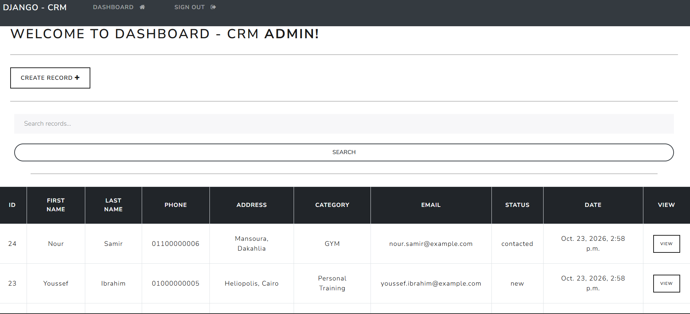
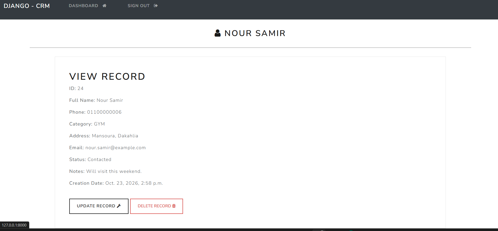

# CRM - Customer Records Manager

A Django web application for managing customer records. Each user has a private
workspace: users can only see and manage their own customers.

## Features
- User registration, login, and logout (session authentication)
- Per-user data isolation (ownership enforced on every view)
- Full CRUD for customer records, with search
- Customer status tracking (New / Contacted / Won / Lost), email, and notes
- Egyptian mobile number validation
- POST-only deletion with CSRF protection
- Automated tests (11 tests: access control and form validation)

## Tech Stack
Python, Django, PostgreSQL, django-crispy-forms (Bootstrap 4), django-environ

## Setup
```bash
git clone <your-repo-url>
cd CRM
python -m venv venv
venv\Scripts\activate        # Windows
pip install -r requirements.txt
```

Copy `.env.example` to `.env` and fill in your values (SECRET_KEY, database credentials).

```bash
python manage.py migrate
python manage.py createsuperuser
python manage.py runserver
```

## Run tests
```bash
python manage.py test
```

## Screenshots

